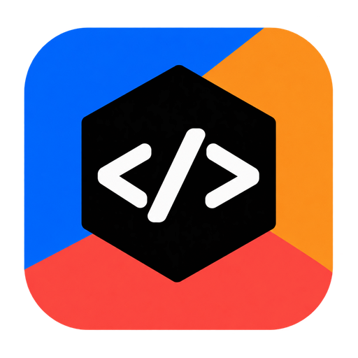

<p align="center">
  
</p>

<h1 align="center">Mixer</h1>

This is a local Mixer fork of Paseo. Build the Electron app with
`npm ci` followed by `npm run build:desktop:local`. The macOS ARM64 app is written
to `packages/desktop/release/mac-arm64/Mixer.app`. Packages are private local
workspaces and are not published to npm. Upstream links below refer to Paseo,
not a published Mixer release. See [local identity and storage](docs/development.md#local-mixer-identity).

<p align="center">
  <a href="README.md">English</a> ·
  <a href="README.zh-CN.md">简体中文</a> ·
  <a href="README.ja.md">日本語</a> ·
  <a href="README.ko.md">한국어</a>
</p>

<p align="center">
  <a href="https://github.com/getpaseo/paseo/stargazers">
    
  </a>
  <a href="https://github.com/getpaseo/paseo/releases">
    
  </a>
  <a href="https://x.com/moboudra">
    
  </a>
  <a href="https://discord.gg/jz8T2uahpH">
    
  </a>
  <a href="https://www.reddit.com/r/PaseoAI/">
    
  </a>
</p>

<p align="center">One interface for Claude Code, Codex, Copilot, OpenCode, Pi, Antigravity, and Muse Code agents.</p>

<p align="center">
  
</p>

Mixer is an open source desktop IDE for coding agents. Open the Electron app and work with agents, an editor, terminals, diffs, pull requests, and a browser in one window. Run agents in separate worktrees, on one machine or several.

- **Parallel agents:** Run many agents at once, each in its own worktree.
- **Built-in orchestration:** Agents in Mixer can create worktrees, launch other agents, and talk to them, across providers.
- **Complete development workflow:** Edit files, review diffs, open pull requests, and run terminals, in split panes you arrange how you want.
- **Self-hosted:** Agents run on your machine with your full dev environment. Use your tools, your configs, and your skills.
- **Multi-provider:** Claude Code, Codex, Copilot, OpenCode, Pi, Antigravity, and Muse Code through the same interface. Pick the right model for each job.
- **Voice control:** Dictate tasks or talk through problems in voice mode. Hands-free when you need it.
- **Remote development:** Connect the desktop app to local or remote hosts, and automate workflows with the CLI.
- **Privacy-first:** Mixer doesn't have any telemetry, tracking, or forced log-ins.

[Run parallel tasks in Mixer](https://paseo.sh/docs/parallel-development): start agents in separate worktrees, review their diffs, run each app, and check it in the built-in browser.

## Sponsors

<!-- Sponsors: one cell per sponsor in the order of packages/website/src/data/sponsors.ts, then "become a sponsor" cells up to three. -->
<table>
  <tr>
    <td align="center" width="33%"><a href="https://hoplite.sh/?utm_source=paseo&utm_medium=readme&utm_campaign=sponsor"><picture><source media="(prefers-color-scheme: dark)" srcset="packages/website/public/sponsors/hoplite-on-dark.svg"></picture></a><br><sub>Cloud coding agents</sub></td>
    <td align="center" width="33%"><a href="https://paseo.sh/sponsor">Become a sponsor</a></td>
    <td align="center" width="33%"><a href="https://paseo.sh/sponsor">Become a sponsor</a></td>
  </tr>
</table>

## Plugins

Plugins run on the daemon and expose their UI in the desktop app.

- **UI:** screens, sidebar items, workspace panels, Command Center items, slash commands, composer pills, attachment sources, timeline items, themes.
- **Agent lifecycle:** change configuration, environment, and MCP servers, answer permissions, follow up when a turn ends.
- **Providers:** add a coding agent as a provider.

Install from the registry with `mixer plugin add owner/slug`, or from Git or a local directory.

**[Browse plugins](https://paseo.sh/plugins)** · **[Plugin docs](https://paseo.sh/docs/plugins)**

Plugins run with access to your daemon machine and inside connected clients; install only code you trust.

## Getting Started

Mixer runs a local server called the daemon that manages your coding agents. The desktop app and CLI connect to it.

### Prerequisites

You need at least one agent CLI installed and configured with your credentials:

- [Claude Code](https://docs.anthropic.com/en/docs/claude-code)
- [Codex](https://github.com/openai/codex)
- [GitHub Copilot](https://github.com/features/copilot/cli/)
- [OpenCode](https://github.com/anomalyco/opencode)
- [Pi](https://pi.dev)
- [Antigravity](https://paseo.sh/docs/supported-providers#antigravity)
- [Muse Code](https://paseo.sh/docs/muse-code)

### Desktop app (recommended)

Build this checkout with `npm run build:desktop:local`, then open the generated
`Mixer.app`. The daemon starts automatically. Upstream download links do not contain
this fork.

### Server

For a server, a VM, or any machine without the desktop app. Install the CLI and start the daemon:

```bash
npm run build:server
node packages/cli/bin/mixer
```

Mixer supports direct TCP, SSH, VPN, and optional encrypted relay connections to remote hosts.

For full setup and configuration, see:

- [Docs](https://paseo.sh/docs)
- [Connectivity guide](https://paseo.sh/docs/connectivity)
- [Configuration reference](https://paseo.sh/docs/configuration)

### Docker

Run the Mixer daemon and self-hosted web UI in Docker:

```bash
docker run -d --name mixer \
  -p 6767:6767 \
  -e MIXER_PASSWORD=change-me \
  -v "$PWD/mixer-home:/home/mixer" \
  -v "$PWD:/workspace" \
  ghcr.io/mixer/mixer:latest
```

Open `http://localhost:6767` after it starts. Extend the base image with the agent CLIs you use, then provide credentials through environment variables or the persistent `/home/mixer` volume. See the [Docker documentation](docs/docker.md) for full setup details.

## CLI

Everything you can do in the app, you can do from the terminal.

```bash
mixer run --provider claude/opus-4.6 "implement user authentication"
mixer run --provider codex/gpt-5.5 --worktree feature-x "implement feature X"

mixer ls                           # list running agents
mixer attach abc123                # stream live output
mixer send abc123 "also add tests" # follow-up task

# run on a remote daemon; --cwd is a path on that host
mixer run --host workstation.local:6767 --cwd /workspace "run the full test suite"
```

See the [full CLI reference](https://paseo.sh/docs/cli) for more.

## TypeScript SDK

Build issue integrations, dashboards, and orchestration services with `@mixer/client`:

```ts
import { createMixerClient } from "@mixer/client";

const client = createMixerClient({ url: "ws://127.0.0.1:6767/ws" });
await client.connect();

const agent = await client.agents.create({
  config: { provider: "codex/gpt-5.5" },
  cwd: "/Users/me/dev/storefront",
  prompt: "Review the current diff and name the riskiest change.",
});

const result = await agent.waitForFinish();
console.log(result.lastMessage);

await client.close();
```

See the [SDK quickstart](https://paseo.sh/docs/sdk/quickstart), [recipes](https://paseo.sh/docs/sdk/recipes), and [API reference](https://paseo.sh/docs/sdk/reference).

## Development

Quick monorepo package map:

- `packages/server`: Mixer daemon (agent process orchestration, WebSocket API, MCP server)
- `packages/app`: Electron's web renderer, built with Expo and React Native Web
- `packages/cli`: `mixer` CLI for daemon and agent workflows
- `packages/desktop`: Electron desktop app
- `packages/relay`: Relay transport and encryption used by the daemon and clients
- `packages/website`: Marketing site and documentation (`paseo.sh`)

Common commands:

```bash
# run all local dev services
npm run dev

# run individual surfaces
npm run dev:server
npm run dev:app
npm run dev:desktop
npm run dev:website

# build the server stack
npm run build:server

# repo-wide checks
npm run typecheck
```

## Support Mixer

Mixer is an independent project used by tens of thousands of developers daily, built by one person and funded by the people who use it. Support the work on [GitHub Sponsors](https://github.com/sponsors/boudra). Companies can [sponsor Mixer](https://paseo.sh/sponsor#spot) monthly and have their logo shown at the top of this README and on the paseo.sh homepage and docs.

## Related projects

- [mixer/mixer-relay](https://github.com/getpaseo/paseo-relay) — official distributed relay, written in Elixir
- [mixer-vscode](https://marketplace.visualstudio.com/items?itemName=hinnes.paseo-vscode) — VS Code extension

## License

Apache-2.0
